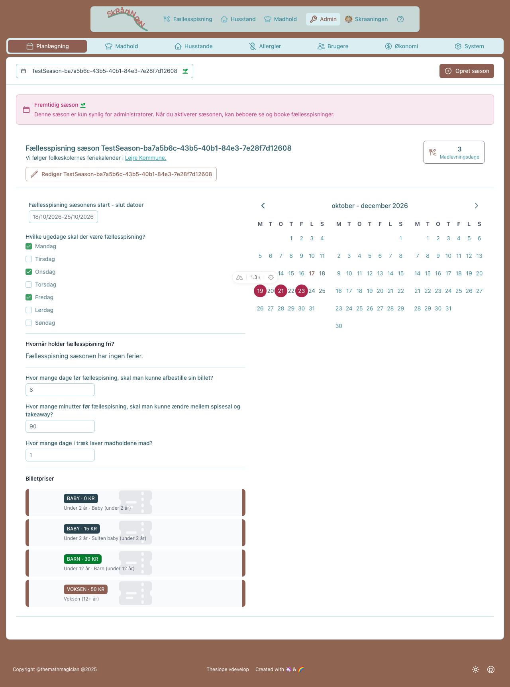
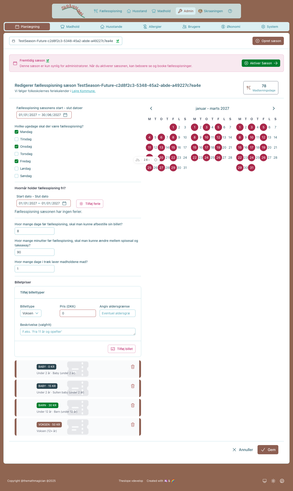
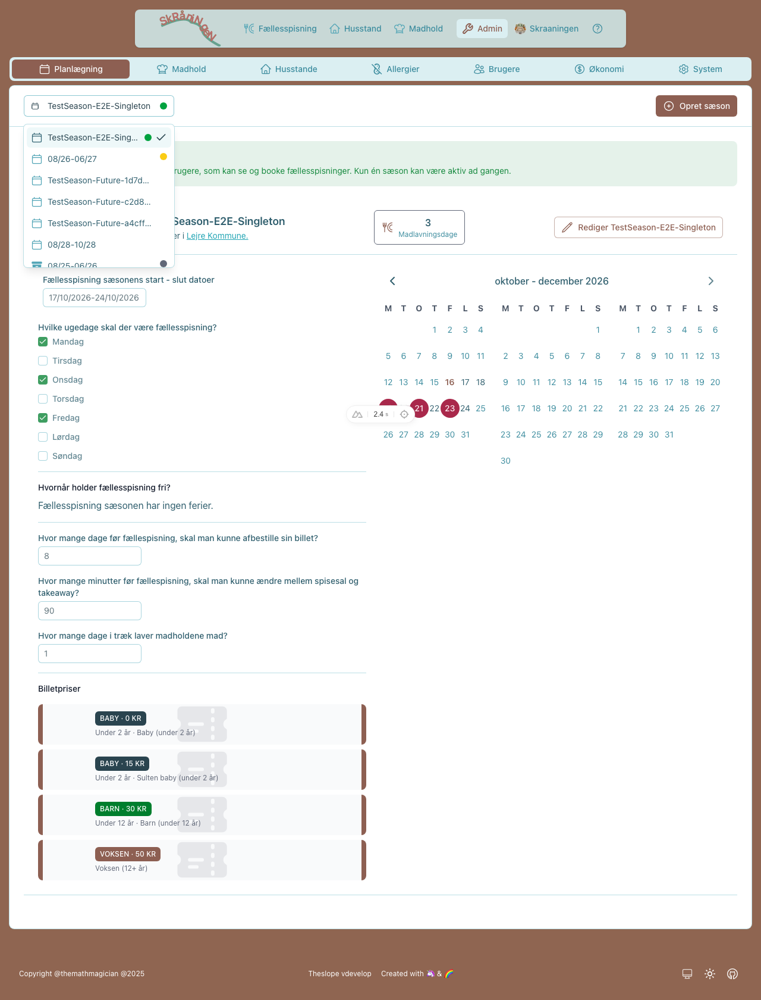
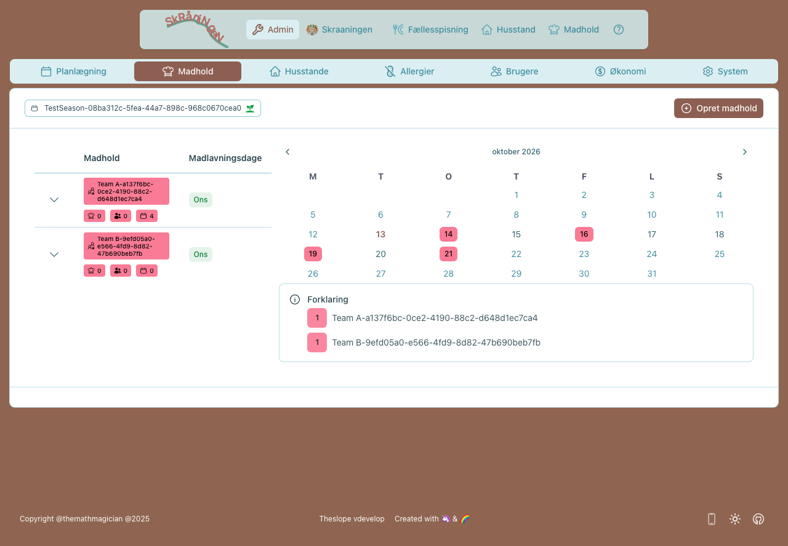
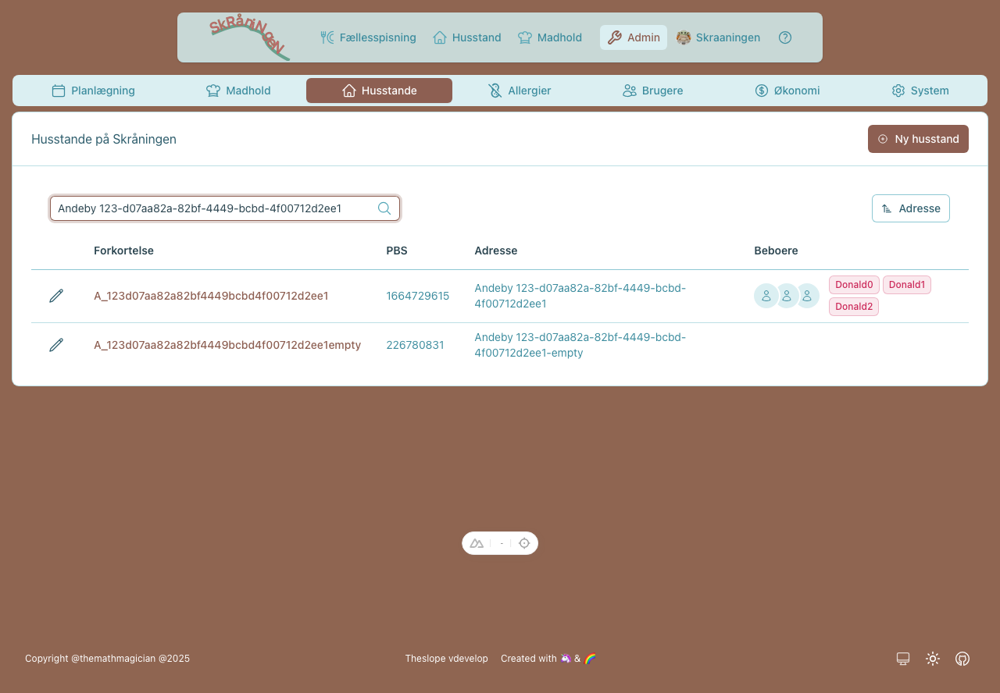

# Administratorguide

Denne guide dækker alle administrative opgaver i TheSlope. Du skal have **ADMIN**-rollen for at redigere.

> **Se også:** [Brugerguide](user-guide.md) | [Chefkokguide](chef-guide.md) | [Systemoversigt](features/features.md) | [Driftshåndbog](ops-runbook.md)

---

## Adgangskontrol

Admin-siden er tilgængelig for alle brugere, men **kun admin kan redigere**:

| Rolle | Kan se | Kan redigere |
|-------|--------|--------------|
| Admin | ✅ Alle faner | ✅ Alle faner |
| Allergi-ansvarlig | ✅ Alle faner | ✅ Kun Allergier |
| Almindelig bruger | ✅ Alle faner | ❌ Ingen |

Ikke-admin ser en **"Se, men ikke røre"**-besked øverst og kan ikke ændre data.

---

## Faner i administrationssiden

| Fane | Formål | Kræver rolle |
|------|--------|--------------|
| **Planlægning** | Opret og administrer sæsoner, ferier, priser | Admin |
| **Madhold** | Opret hold, tildel medlemmer, jokere og madlavningsdage | Admin |
| **Husstande** | Opret og redigér husstande, flyt beboere ved flere husstande på samme adresse | Admin |
| **Allergier** | Administrer allergi-katalog, bemærkninger og plakat | Admin eller Allergi-ansvarlig |
| **Brugere** | Se brugere, tildel systemroller | Admin |
| **Økonomi** | Se fakturaer og økonomioversigt, del med bogholder | (kun visning) |
| **System** | Kør systemjobs, se jobhistorik | Admin |

---

## Hurtig oversigt

| Opgave | Hvor |
|--------|------|
| Opret ny sæson | [Planlægning](https://www.skraaningen.dk/admin/planning) → **Opret sæson** |
| Aktivér eller redigér sæson | [Planlægning](https://www.skraaningen.dk/admin/planning) → Sæsonvælger |
| Administrer madhold | [Madhold](https://www.skraaningen.dk/admin/teams) |
| Opret og redigér husstande / flyt beboere | [Husstande](https://www.skraaningen.dk/admin/households) |
| Administrer allergityper, print plakat | [Allergier](https://www.skraaningen.dk/admin/allergies) |
| Se brugere og roller | [Brugere](https://www.skraaningen.dk/admin/users) |
| Se økonomioversigt, del med bogholder | [Økonomi](https://www.skraaningen.dk/admin/economy) |
| **Ret bookinger (admin)** | [Økonomi](https://www.skraaningen.dk/admin/economy) → Fremtidige bestillinger |
| Kør systemjobs | [System](https://www.skraaningen.dk/admin/system) |
| Importér sæson fra CSV | `make theslope-import-season-*` |
| Eksportér holdmedlemmer til CSV | `make theslope-export-teams env=<env>` |
| Synkronisér fra Heynabo | [System](https://www.skraaningen.dk/admin/system) → **Heynabo** (kører også hver nat) |

---

## Sæsonstyring

### Sådan opretter du en ny sæson

1. Gå til [Planlægning](https://www.skraaningen.dk/admin/planning)
2. Klik **Opret sæson**
3. Udfyld:
   - **Sæsondatoer** - Start- og slutdato
   - **Madlavningsdage** - Hvilke ugedage der er fællesspisning (typisk man-tors)
   - **Ferier** - Perioder uden madlavning (skoleferier osv.)
   - **Billetpriser** - Priser for voksen, barn og baby
4. Klik **Gem**

Systemet opretter automatisk middagsbegivenheder for alle madlavningsdage i perioden.



### Sådan aktiverer du en sæson

Når du aktiverer en sæson, bliver den synlig for alle brugere, og automatiske tilmeldinger oprettes.

1. Gå til [Planlægning](https://www.skraaningen.dk/admin/planning)
2. Brug sæsonvælgeren til at finde sæsonen
3. Find sæsoner med  (fremtidig) eller  (inaktiv) status
4. Klik **Aktiver Sæson**



**Hvad sker der ved aktivering:**
- Sæsonen bliver synlig for alle ( status)
- Tilmeldinger oprettes ud fra beboernes præferencer
- Kun middage inden for 60 dage bliver booket
- Afmeldinger respekteres (systemet genskaber ikke afmeldte billetter)

### Sådan redigerer du en sæson

Datoer, madlavningsdage, ferier og priser kan rettes - også på den aktive sæson:

1. Vælg sæsonen i sæsonvælgeren og klik på **blyanten**
2. Ret datoer, ugedage eller ferier
3. Klik **Gem** - kvitteringen fortæller hvad der skete, f.eks. *"Sæson opdateret — 3 datoer tilføjet, 1 fjernet. Forudbestillinger er opdateret. Husk at tildele madhold til nye datoer."*
4. Gå til [Madhold](https://www.skraaningen.dk/admin/teams) og giv de nye datoer et hold

Skal sæsonen af igen, finder du **Deaktiver Sæson** i samme redigeringsvisning.

### Sæsonstatusikoner

Sæsonvælgeren viser sæsonerne i rækkefølgen aktiv, inaktiv, fremtidig, arkiveret og vælger den sæson, der er i gang.

| Ikon | Status | Betydning |
|:----:|--------|-----------|
|  | Aktiv | Synlig for brugere, tilmeldinger aktive |
|  | Inaktiv | Datoerne er nu, men sæsonen er ikke aktiveret |
|  | Fremtidig | Kan aktiveres, datoer er i fremtiden |
|  | Arkiveret | Afsluttet, kan ikke genaktiveres |



---

## Madhold

Fanen viser sæsonens hold i en tabel med deres madlavningsdage. Uden valg står alle holds kalender ved siden af; klik på en række, og holdets detaljer tager pladsen.

### Sådan opretter du madhold

1. Gå til [Madhold](https://www.skraaningen.dk/admin/teams) og vælg sæsonen i dropdown-menuen
2. Klik **Opret madhold** øverst til højre
3. Vælg antal hold - de nye hold nummereres i forlængelse af de eksisterende
4. Klik **Opret N madhold**

### Sådan redigerer du et madhold

1. Klik på holdets række i tabellen
2. Klik på **blyanten** (Rediger) i holdets hoved
3. Ret holdnavn, madlavningsdage eller medlemmer - alt gemmes med det samme
4. Klik **Tilbage**, når du er færdig



### Sådan tilføjer du holdmedlemmer

1. I redigeringsvisningen, skriv navnet under **Tilføj medlemmer**
2. Klik **Tilføj** ud for beboeren — formularen åbner under rækken
3. Vælg rolle, arbejdstid og eventuelle ugedage
4. Klik **Tilføj**

Beboere kan være medlem af flere hold. Klik **Rediger** for at ændre rolle, arbejdstid eller ugedage for et eksisterende medlem.

### Sådan tilføjer du en joker

En joker er en plads uden navn - f.eks. en vikar for en kok på barsel, eller en ekstra hånd i en travl periode.

1. I redigeringsvisningen, klik **Tilføj** på rækken **Joker · en plads uden navn**
2. Udfyld **Periode**, **Ugedage**, **Rolle**, **Arbejdstid** og en **Note** (f.eks. "Anna barsel")
3. Klik **Tilføj** - jokeren står i sin egen boks på holdkortet med antal madlavningsdage

---

## Husstande

### Sådan ser du husstande

1. Gå til [Husstande](https://www.skraaningen.dk/admin/households)
2. Brug søgefeltet til at filtrere på adresse eller navn



### Sådan opretter du en husstand

Bruges når en ny familie flytter ind - også mens den gamle stadig bor på adressen:

1. Klik **Ny husstand** over tabellen
2. Vælg **Adresse** fra listen og skriv husstandens **PBS**-nummer
3. Vælg indflytningsdato
4. Bor der allerede en husstand på adressen, sætter du dens fraflytningsdato i samme formular
5. Klik **Opret husstand**

### Sådan redigerer du en husstand

1. Gå til [Husstande](https://www.skraaningen.dk/admin/households)
2. Klik på blyant-ikonet ud for husstanden
3. Panelet viser stamdata (PBS, adresse, Heynabo-ID) og residensstatus

### Sådan flytter du en beboer

Beboere kan flyttes mellem husstande på **samme adresse** (samme Heynabo-ID). Dette bruges f.eks. når en ny husstand oprettes ved fraflytning, og en beboer skal tilknyttes den nye husstand.

1. Åbn redigeringspanelet for mål-husstanden
2. Find beboeren i listen (viser kun beboere på samme adresse)
3. Klik **Flyt hertil**
4. Systemet opdaterer tilknytningen og genberegner bookinger

> **Bemærk:** Heynabo-import forsøger at gætte hvilken husstand nye beboere tilhører, men nogen gange skal dette korrigeres af admin. Heynabo-import respekterer admin-flytninger.

### Admin-adgang til husstandssider

Admin kan besøge enhver husstands side og aktivere admin-tilgang:

1. Gå til en husstand via linket i husstandstabellen
2. Klik **Admin røre alligevel** på banneret "Du besøger nu en anden husstand end din egen", og **Klik igen for at låse op**
3. Banneret skifter til "Admin rører, men forsigtigt", og nu kan du ændre på vegne af beboerne:
   - **Præferencer** — ændre madpræferencer (genberegner bookinger)
   - **Fraflytningsdato** — sætte eller fjerne fraflytningsdato (genberegner bookinger)
   - **Bookinger** — rette tilmeldinger også efter deadline er passeret
4. Klik **Afslut**, når du er færdig

Hver ændring logges med dig og husstanden. Den allergiansvarlige har samme knap på husstandens **Allergier**-fane og
retter husstandens allergier derfra.

### Sådan sletter du en husstand

1. Åbn redigeringspanelet for husstanden
2. Flyt eventuelle beboere til en anden husstand først
3. Klik **Slet** nederst og bekræft med endnu et klik - knappen fortæller hvor mange beboere der følger med

---

## Allergityper

Admin og allergi-ansvarlige kan redigere allergi-kataloget.

### Sådan opretter du en allergitype

1. Gå til [Allergier](https://www.skraaningen.dk/admin/allergies)
2. Klik **Opret**
3. Udfyld navn, beskrivelse og ikon (emoji)
4. Klik **Gem**

### Sådan ser du hvem der har en allergi

1. Gå til [Allergier](https://www.skraaningen.dk/admin/allergies)
2. Klik på en allergitype i listen
3. Se alle beboere med denne allergi og deres kommentarer

### Kombiner allergener

1. Klik **Kombiner allergener**
2. Marker de allergityper du vil se
3. Se samlet antal påvirkede beboere
4. Brug til menuoverblik (f.eks. "Ingen nødder i dag") - **Afslut kombinering** lukker visningen igen

### Plakat til køkkenet

1. Klik **Plakat** i katalogets hoved - plakaten åbner som en printvenlig side
2. Plakaten viser alle beboere med allergier, fordelt på aldersgrupper efter den aktive sæsons billettyper, og en QR-kode til den opdaterede liste
3. Print den og hæng den op i køkkenet

**Vigtige bemærkninger** i katalogets hoved printes med på plakaten. Klik på **blyanten** i boksen, skriv én bemærkning per linje (f.eks. "Glutenfri boller findes i fryseren") og klik **Gem**.

> **Bemærk:** Sletning af en allergitype fjerner automatisk alle registreringer for den type (CASCADE).

---

## Brugere

Brugerfanen viser alle brugere importeret fra Heynabo.

### Sådan ser du brugere

1. Gå til [Brugere](https://www.skraaningen.dk/admin/users)
2. Brug søgefeltet til at finde brugere på navn eller email
3. Klik på pilen ved en bruger for at se detaljer

På telefonen scroller tabellen sidelæns, og pilen åbner brugerens profilkort.

### Systemroller

Admin kan tildele systemroller til brugere:

| Rolle | Beskrivelse | Tildeles af |
|-------|-------------|-------------|
| **ADMIN** | Fuld adgang til alle administrative funktioner | Heynabo (via Bestyrelse-rolle) |
| **ALLERGYMANAGER** | Kan redigere allergi-kataloget og husstandenes allergier (via **Admin røre alligevel**) | Admin i TheSlope |

### Sådan tildeler du Allergi-ansvarlig rollen

1. Gå til [Brugere](https://www.skraaningen.dk/admin/users)
2. Find brugeren og klik på pilen for at udvide
3. Under "Systemroller", slå "Allergi-ansvarlig" til
4. Ændringen gemmes automatisk

> **Bemærk:** ADMIN-rollen styres af Heynabo og kan ikke ændres i TheSlope.

---

## Import og eksport

### Sæsonimport (CSV)

Importér sæsonkalender og holdtildelinger fra CSV-filer.

```bash
make theslope-import-season-prod    # Produktion: calendar.csv + teams.csv
make theslope-import-season-dev     # Dev: calendar.csv + test_teams.csv
make theslope-import-season-local   # Lokal: calendar.csv + test_teams.csv
make theslope-import-season-prod TEAMS_CSV_PROD=.theslope/team-import/teams-prod.csv   # anden holdfil (dev/lokal: TEAMS_CSV_TEST)
```

**Placering af CSV-filer:** `.theslope/team-import/`

Sæsonens navn (`MM/yy-MM/yy`) dannes af første og sidste række i `calendar.csv`. Findes en sæson med det navn, opdateres den; ellers oprettes en ny sæson.

**Import i en eksisterende sæson:**
- Datoer, madlavningsdage og ferier kommer fra `calendar.csv`, og middagene følger dem: middage på feriedatoer slettes, madlavningsdage uden middag får en
- Hver middag får holdet fra sin række i `calendar.csv`
- Hold får de medlemmer fra `teams.csv`, der mangler; eksisterende medlemmer beholder deres rolle
- Frister sættes til standardværdierne i `app/app.config.ts`; standardbilletpriser, der mangler, tilføjes
- Sæsonen bliver inaktiv. Aktivér den igen som beskrevet i [Sådan aktiverer du en sæson](#sådan-aktiverer-du-en-sæson)

#### `calendar.csv` - Sæsonplan

```csv
date,weekday,team
11-08-2025,mandag,1
12-08-2025,tirsdag,1
13-10-2025,mandag,Efterårsferie
```

| Kolonne | Format | Beskrivelse |
|---------|--------|-------------|
| date | DD-MM-YYYY | Madlavningsdato |
| weekday | Dansk | mandag, tirsdag, onsdag, torsdag |
| team | Nummer eller tekst | Holdnummer (1-8) eller ferienavn |

Filen har én række pr. madlavningsdag fra sæsonens første til sidste dag. Tekst i `team` er et ferienavn, og fortløbende rækker med samme navn bliver én ferie, fx `Efterårsferie`, `Juleferie`, `Vinterferie`, `Påskeferie`, `Kr. Himmelfart`, `Pinse`, `FRIT`.

#### `teams.csv` - Holdtildelinger

```csv
team,role,name,affinity
Madhold 1,CHEF,Maria,
Madhold 1,COOK,Søren L.,man
Madhold 1,JUNIORHELPER,Asta G.,man
```

Filen har mindst én medlemsrække.

#### Eksport af holdmedlemmer

```bash
make theslope-export-teams env=prod   # env=local|dev|prod; expect: <antal> members → .theslope/team-import/teams-prod.csv
```

Skriver den aktive sæsons holdmedlemmer i `teams.csv`-formatet med fulde navne til `.theslope/team-import/teams-<env>.csv`. En import med denne fil beholder holdenes medlemmer, som de er.

#### Navnematching

| Format | Eksempel | Matcher |
|--------|----------|---------|
| Fuldt navn | `Maria Hansen` | Fornavn + efternavn |
| Kun fornavn | `Maria` | Unikt fornavn |
| Fornavn + initial | `Søren L.` | Fornavn + efternavn der starter med L |
| Fornavn + flere initialer | `Mads B.H.` | Fornavn + efternavn "Bruun Hovgaard" |

Tjek `unmatchedNames` i svaret - disse skal tildeles manuelt eller rettes i CSV.

### Heynabo-import

Synkronisér husstande og beboere fra Heynabo. På dev og prod: Admin → System → Heynabo-import. Lokalt:

```bash
make theslope-login-local && make theslope-admin-import   # GET /api/admin/heynabo/import på den lokale server
```

---

## Økonomi

### Faktureringsperioder

Perioden lukker den 17., og faktureringen kører automatisk den 18. hver måned:
- **Forbrugsperiode**: 18. forrige måned → 17. denne måned
- **PBS-opkrævning**: 1. i efterfølgende måned

### Sådan kommer fakturaoplysningerne til bogholderen

Hver kørsel sender periodens PBS-fil (CSV) med mail til bogholderen (`<bogholder-mailbox>`) med admin-postkassen (`<admin-mailbox>`) i kopi, og lægger filen i arkivet. Kører perioden igen, går der en ny mail med "opdatering v2", "v3" osv., som erstatter den forrige. Postkasserne sættes op som beskrevet i [driftshåndbogen](ops-runbook.md).

Vil du dele manuelt:

1. Gå til [Økonomi](https://www.skraaningen.dk/admin/economy)
2. Vælg en lukket faktureringsperiode
3. Ved **Del med bogholder** åbner du den offentlige side eller kopierer links til siden og til CSV-filen
4. Send linket - det virker uden login

### Sådan retter du bookinger (Admin-korrektioner)

Som admin kan du rette bookinger for alle husstande - også efter deadline er passeret.

**Hvornår bruges dette:**
- Beboer glemte at tilmelde sig
- Forkert booking opdaget efter deadline
- Beboer misforstod præferencer

**Sådan gør du:**

1. Gå til [Økonomi](https://www.skraaningen.dk/admin/economy)
2. Find middagen under **Fremtidige bestillinger** og fold den ud
3. Klik **Admin Korrektion** - og en gang til, når knappen spørger
4. Vælg husstand i dropdown-menuen
5. Redigér tilmeldinger:
   - Tilføj/fjern personer
   - Ændr spisningsform (Spisesal, Sen, Takeaway)
   - Tilføj/fjern gæster
6. Se **forhåndsvisning** af ændringer
7. Klik **Gem ændringer**

**Admin-rettelser omgår:**
- Frameldingsfristen (sæsonens, som regel 8 dage)
- Afmeldingsregler (slet i stedet for frigiv)

> **Bemærk:** Kun middage med bestillinger kan foldes ud. En middag uden bestillinger retter du fra husstandens side
> (se Admin-adgang til husstandssider).

> **Bemærk:** Admin-rettelser logges med dit bruger-ID og står som "ADMIN korrektion" i Billetændringer - også når du
> retter fra husstandens side.

---

## Systemvedligeholdelse

### [Systemjobs](https://www.skraaningen.dk/admin/system)

| Job | Kørsel | Beskrivelse |
|-----|--------|-------------|
| Heynabo import | Dagligt kl. 02:00 | Synkroniser husstande og beboere fra Heynabo |
| Daglig vedligeholdelse | Dagligt kl. 03:00 | Afslut middage, luk ordrer, opret transaktioner, ryd ventelister på afholdte middage, tilmeldinger (rolling window 60 dage), sælg billetter til salg til ventelisten |
| Månedlig fakturering | D. 18. hver måned kl. 04:00 | Luk perioden, send CSV til bogholderen, arkivér |

### Sådan kører du et job manuelt

1. Gå til [System](https://www.skraaningen.dk/admin/system)
2. Find jobbet i oversigten
3. Klik jobbets knap: **Kør import**, **Kør daglig vedligeholdelse** eller **Kør fakturering**
4. Boksen viser jobbets seneste kørsel: tidspunkt, status og resultat - og fejlen under kørslen, hvis den fejler. Kørslen står også i **Jobhistorik**

Et job uden kørsler viser **Ingen kørsler endnu**. På telefonen scroller **Jobhistorik** sidelæns.

Alle jobs er idempotente og kan køres igen uden problemer.

---

## FAQ

*Spørgsmål tilføjes løbende baseret på brugerhenvendelser.*

---

*Sidst opdateret: Oktober 2026 (sæsonmærker, ventelisten i den daglige vedligeholdelse, madhold-fanen og jokere, sæsonredigering, allergiplakat, mail til bogholder, ny husstand, den allergiansvarliges adgang, jobboksenes seneste kørsel)*
