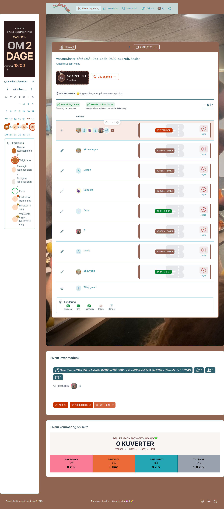
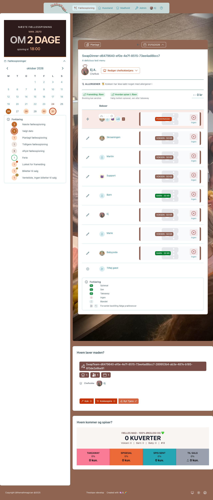

# Chefkokguide

Denne guide er til dig, der er chefkok på et madhold.

> **Se også:** [Brugerguide](user-guide.md) | [Administratorguide](admin-guide.md) | [Systemoversigt](features/features.md)

---

## Dine deadlines

Hver middag på [Chef-siden](https://www.skraaningen.dk/chef) har tre chips, der tæller ned:

| Chip | Hvornår | Hvad skal du gøre? |
|------|---------|--------------------|
| **Menu** | 10 dage før middagen | Publicer din menu, så beboerne kan tilmelde sig |
| **Framelding** | Sæsonens frist - som regel 8 dage før | Tilmeldingen lukker. Herefter kan beboerne kun frigive billetter, og du kan regne med kuverterne i køkkenpanelet |
| **Indkøb** | Inden middagen | Skriv dine indkøb ind under **Madbestilling** - så er chippen grøn |

Farven fortæller, hvor meget tid du har:

- **Grøn** - god tid
- **Gul** - under 72 timer
- **Rød** - under 24 timer
- **Kranie** - fristen er overskredet, men det er aldrig for sent

---

## Trin for trin

### 1. Bliv chefkok

Kokkehuen hopper ikke selv op på hovedet. Når du har aftalt med dit madhold — eller de andre chefkokke — at du tager tjansen en bestemt dag, melder du dig som chefkok i appen.

Mangler en middag en chefkok, lyser portrættet med et stort **WANTED**, som en eftersøgt fra det vilde vesten. Du finder middagene to steder:

- **Middagskalenderen** ([dinner](https://www.skraaningen.dk/dinner)) — viser alle middage
- **Chefsiden** ([chef](https://www.skraaningen.dk/chef)) — viser middagene for de madhold du selv er på

Klik **Bliv chefkok**, bekræft — og dit ansigt pryder portrættet. Tjansen er din.

*WANTED — denne middag mangler en helt*

*Tjansen er landet — nu er det dig der svinger grydeskeen*

> **Fortrød du?** Klik **Ændre tjans** på portrættet og vælg **Meld afbud** (to klik — vi vil være helt sikre). Tjansen bliver ledig igen, WANTED-skiltet popper op, og din menu nulstilles til den næste helt.
>
> **Bytter I?** Har en anden kok lovet at tage dagen, klikker vedkommende på **Ændre tjans** ved dit portræt og vælger **Overtag Chefkok-tjansen fra [dit navn]**. Et **Ja tak, jeg overtager Chefkok-tjansen** senere skifter tjansen hænder — uden at WANTED-skiltet kommer frem.

---

### 2. Planlæg din menu

1. Gå til [Chef](https://www.skraaningen.dk/chef)
2. Klik på den middag du er chefkok for
3. Udfyld **Menu titel** (kort beskrivelse af retten)
4. Udfyld **Beskrivelse** (detaljer om maden)
5. Klik **Gem**

---

### 3. Angiv allergener

1. Find linjen **ALLERGENER** under menuen og klik **Rediger allergener**
2. Marker hvilke allergener din menu indeholder (f.eks. gluten, nødder, mælk) og klik **Gem**
3. Linjen viser nu hvor mange kuverter der er ramt, allergen for allergen - f.eks. *3,5 kuv. | Mælk · 2,5*
4. Tilpas menuen eller forbered alternativer til de ramte

---

### 4. Publicer til Heynabo

⏰ *Deadline: 10 dage før middagen*

1. Når din menu er klar, klik på **Publicer** - knappen skifter til **Publiceret**
2. Menuen overføres automatisk til Heynabo-kalenderen
3. Beboere kan nu se menuen i Heynabo-appen

> **Bemærk:** Hvis du ændrer menuen senere, synkroniseres ændringerne automatisk til Heynabo.

---

### 5. Tjek tilmeldinger

1. Gå til din middag på [Chef](https://www.skraaningen.dk/chef)
2. Se **køkkenpanelet** med overblik over tilmeldinger:

**Køkkenpanelet viser:**

| Kategori | Indhold |
|----------|---------|
| **Total kuverter** | Samlet antal portioner (voksen, barn, baby) |
| **Takeaway** | Antal og procentdel der henter mad |
| **Spisesal** | Antal og procentdel der spiser i salen |
| **Spis sent** | Antal og procentdel der kommer sent |
| **Til salg** | Frigivne billetter der kan overtages |
| **Allergier** | Under hver kategori: hvor mange kuverter der har et af menuens allergener |

**Klik på en kategori** for at se detaljeret opdeling:
- Allergenerne øverst, med antal kuverter for hvert
- Hvilke husstande der har tilmeldt sig, og billettyper per husstand (voksen/barn/baby)
- Hvem der har et af menuens allergener - allergenets ikon står ud for navnet

> **Tip:** Brug husstandsoversigten til at planlægge portionsstørrelser og allergihensyn.

---

### 6. Madbestilling og budget

Når du har handlet, skriver du beløbet ind, så budgettet følger med:

1. Find linjen **MADBESTILLING** på din middag og klik **Rediger madbestilling**
2. Skriv beløbet fra bonen, vælg **Ex moms** eller **Inkl. moms** som bonen er skrevet, og klik **Tilføj**
3. Linjen gemmes med det samme - med dato og dig som bestiller. Skraldespanden fjerner den igen
4. Klik **Tilbage** for at folde sektionen sammen

Over linjerne står hjælpetallene **Rådighedsbeløb**, **Brugt** og **Til rådighed** - med et flueben når der er penge tilbage, og et udråbstegn når du er over. Laver dit madhold mad flere dage i træk, står holdets samlede saldo for de dage på sin egen linje.

**Budget**-sektionen nedenunder viser tre bokse:

| Boks | Indhold |
|------|---------|
| **Indtægter** | Alle betalte billetter - også dem der er frigivet efter fristen |
| **Rådighedsbeløb** | Indtægter minus køkkenbidrag: det du kan handle for. Med **Brugt** og **Til rådighed** |
| **Køkkenbidrag** | 5 % af indtægterne, som går til køkkenet |

Alle beløb står som **ex / inkl. moms**. Fold sektionen ud for **Billetter** (fordelt på voksen, barn og baby), **Billetændringer** siden menufristen - med **Vis fuld historik** - og holdets runde, hvis I laver mad flere dage i træk.

---

### 7. På madlavningsdagen

1. Tjek tilmeldinger en sidste gang for eventuelle ændringer
2. Afbud efter deadline vises i oversigten - beboeren betaler stadig

---

## Kalender og agenda

Øverst på [Chef-siden](https://www.skraaningen.dk/chef) tæller **Næste madlavning** ned til din næste tjans. Under uret skifter du mellem **Agenda** (listen med chips) og **Kalender** (måneden med ringe i samme farver). Pilen til højre folder dem sammen, så middagen får hele skærmen.

---

## Aflysning

Hvis middagen ikke kan afholdes:

1. Gå til middagen på [Chef](https://www.skraaningen.dk/chef)
2. Klik på **tandhjulet** i knaprækken - farezonen folder sig ud
3. Klik **Aflys middagen** og bekræft med **Tryk igen for at aflyse [dato]**

**Hvad sker der:**
- Middagen markeres som AFLYST
- Billetterne til middagen faktureres aldrig
- Heynabo opdateres automatisk

**Fortryd aflysning:** Klik **Annuller aflysning** og bekræft med **Tryk igen for at genåbne [dato]**.

> **Skal du blot melde fra som chefkok?** Brug **Ændre tjans** ved kokkens portræt - så bliver middagen stående, og WANTED-skiltet finder den næste helt.

---

## Dit madhold

| Rolle | Ansvar |
|-------|--------|
| **Chefkok** | Planlægger menu, handler ind, leder køkkenet |
| **Kok** | Hjælper med tilberedning |
| **Kokkespire** | Lærer at lave mad, lettere opgaver |
| **Joker** | En plads uden navn i en periode - f.eks. en vikar for en kok på barsel. Admin sætter dem ind |

Se dine holdmedlemmer på [Chef](https://www.skraaningen.dk/chef).

---

*Sidst opdateret: Oktober 2026 (madbestilling og budget, overtag tjansen, allergener per kuvert)*
