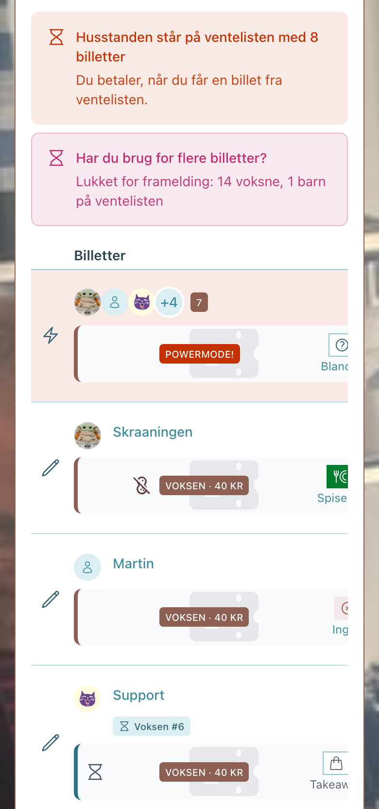
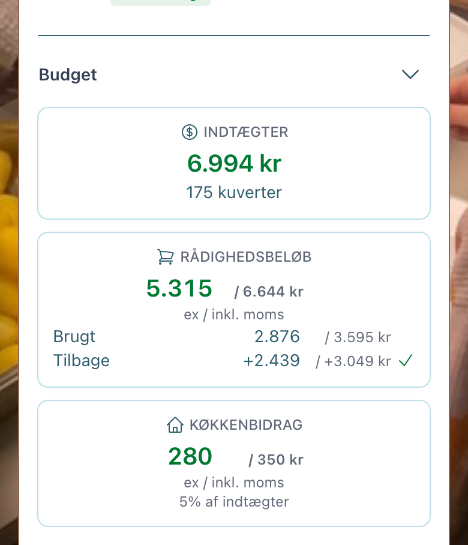

# Nyt i Skrånerappen

**Version 0.9** er rullet ud. Den store nyhed er ventelisten: er en middag udsolgt, stiller du dig i kø, og billetten kommer til dig.

> [!TIP]
>  **Har du installeret den som en app på din telefon?** Så ligger den på hjemmeskærmen som alle andre apps.
>
> | Telefon | Browser | Sådan |
> |---|---|---|
> | Android | Chrome, Edge | Tryk  **Installér app** på forsiden |
> | Android | Firefox | Browserens menu → **Føj til startskærm** (Firefox har ingen installér-knap) |
> | iPhone, iPad | Safari | **Del-menuen** → **Føj til hjemmeskærm** |

<table>
<tr>
<th width="50%" align="left">

 Til alle

</th>
<th width="50%" align="left">

 Til Chefkokkene

</th>
</tr>
<tr>
<td valign="top">

 **Venteliste.** Udsolgt? Tryk **Skriv på venteliste**. Én kø per billettype — Voksen, Barn, Baby — først til mølle. Din plads står på billetten: **Voksen #6**. Frigiver en nabo en billet af din type, går den til den første i køen. Køberen får en mail, med mindre man ikke gider mails, og har meldt det fra.

 **Frigiv** virker som før: er *Framelding* lukket, ryger din billet **til salg**, og den første i køen kan købe den. Solgt? Så slipper du for regningen — kvitteringen siger *solgt* eller *til salg*.

 **Se, mere præcist hvad der vil ske med husstandens bestillinger, før du trykker Gem.** Dag for dag: *tilmeldes*, *frameldes*, *billet til salg*, *skrives på ventelisten* — i Tilmeldinger, i Præferencer og med gæster.

 **Forventet bestilling ifølge præferencer.** Kig måneder frem og se, hvad præferencerne vil booke, tonet ned i gråt. Skal du ikke med den dag? Du kan afbestille måneder frem i tiden - ved at vælge **Ingen**  

 **Gæster.** **Tilføj gæst** i dag- og ugevisningen; efter fristen køber gæsten en billet til salg eller stiller sig i køen. 

</td>
<td valign="top">

 **Madbestilling og budget.** Skriv, hvad indkøbet hos Hørkram og raidet til Lokalbrugsen koster (ex/inkl. moms), og appen regner på dit **Rådighedsbeløb** — Brugt, Tilbage og **Køkkenbidrag** på 5 % — for dig og for holdet.

 **Se billetændringer.** Hvem ændrede hvad, og hvornår — Husstand, Af, Ændring, Billetter · kuverter, Indtægter. *Framelding lukker* deler før og efter fristen; **Vis fuld historik** åbner resten.

 **Kan du frigive portioner?** Bliver køen lang, får du en mail. Er der mad nok, kan du frigive ekstra kuverter — de første i køen får billet og mail.

 **Hvem kommer og spiser?** Kuverter per spisemåde — Takeaway, Spisesal, Spis sent — plus til salg og venteliste, med allergierne regnet med. Allergenlinjen tæller ramte kuverter, allergen for allergen.

 **Hvem laver maden?** **Byt tjans**, eller tag den selv med **Bliv chefkok**. Mangler kokken, lyser WANTED-skiltet. Tre chips tæller ned: Menu, Framelding, Indkøb — grøn, gul, rød. Og kranie, når det er for sent.

</td>
</tr>
</table>

 **Til udviklere:** pakkerne, beslutningerne og dækningen står i [release-0.9.0.md](../features/this-pr/release-0.9.0.md), arkitekturen i [docs/adr.md](../adr.md) (ADR-011, -016, -017), specs, OpenAPI og BDD-resultater på [developer.skraaningen.dk](https://developer.skraaningen.dk).

**skraaningen.dk** · Fejl eller forslag? Tryk på  i appen og vælg **Rapporter fejl**. · Oktober 2026
