# Brugerguide til Skråningens Fællesspisning

Velkommen til TheSlope - Skråningens system til fællesspisning! Denne guide hjælper dig med de mest almindelige opgaver.

> **Se også:** [Chefkokguide](chef-guide.md) | [Administratorguide](admin-guide.md) | [Systemoversigt](features/features.md)

> **Tip:** Klik på hjælp-ikonet (?) i øverste højre hjørne for kontekstafhængig hjælp på hver side.

---

## For at bruge Skrånerappen...

Før du kan logge ind, skal du sikre dig følgende i **Heynabo**:

1. **Du har en Heynabo-konto** - Login bruger din Heynabo email og password
2. **Dine børn er tilføjet med fødselsdato** - Vigtigt! Billetprisen beregnes ud fra alder:
   - **Baby** (0-1 år) - gratis
   - **Barn** (2-11 år) - reduceret pris
   - **Voksen** (12+ år) - fuld pris

> **Vigtigt for forældre:** Tjek at dine børn er registreret i Heynabo **med korrekt fødselsdato**. Uden fødselsdato betaler du voksenpris for alle børn! Tilføj eller ret børnenes fødselsdato i Heynabo - så synkroniseres det automatisk til Skrånerappen.

### Sådan tjekker du dine børns billettype

1. Log ind på [skraaningen.dk](https://www.skraaningen.dk)
2. Gå til [Husstanden](https://www.skraaningen.dk/household) (fanen med hus-ikon)
3. Se listen over husstandens medlemmer
4. Hver person vises med deres billettype: Baby, Barn eller Voksen

Står dit barn som **Voksen** selvom de er under 12 år? Så mangler fødselsdatoen i Heynabo. Ret det i Heynabo-appen, og det opdateres automatisk i Skrånerappen.

---

## Hurtige links

| Sektion | Link | Beskrivelse |
|---------|------|-------------|
| **Forside** | [skraaningen.dk](https://www.skraaningen.dk) | Log ind for at se kommende middage, booke pladser, administrere din husstand og vælge dine egne indstillinger |
| **Middagskalender** | [skraaningen.dk/dinner](https://www.skraaningen.dk/dinner) | Se alle kommende fællesspisninger. Klik på en dato for at se menu, tilmeldinger og madhold. Du kan også ændre mellem spisesal, takeaway og sen spisning, ændre tilmelding for en dato, tilmelde en gæst, købe en billet til salg, eller skrive dig på ventelisten |
| **Chef-side** | [skraaningen.dk/chef](https://www.skraaningen.dk/chef) | Din oversigt som chefkok. Se dine kommende madlavningsdage, annoncer menuer og hold styr på tilmeldinger, allergier og budget |
| | | |
| **Husstand** | | |
| › Tilmeldinger | [.../bookings](https://www.skraaningen.dk/household) | Se og administrer dine bookinger til fællesspisning. Book måltider for din husstand og se kommende arrangementer |
| › Præferencer | [.../members](https://www.skraaningen.dk/household) | Power mode opdaterer alle medlemmer samtidigt. Klik på blyanten for at redigere enkeltpersoner. Udvid rækken for at se valgmuligheder. Ændringer gemmes når du trykker Gem |
| › Allergier | [.../allergies](https://www.skraaningen.dk/household) | Administrer allergier og fødevareintoleranser for din husstand. Tilføj og opdater allergioplysninger for hver beboer |
| › Økonomi | [.../economy](https://www.skraaningen.dk/household) | Se økonomisk oversigt for din husstand. Følg udgifter til fællesspisning og se fakturaer |
| › Indstillinger | [.../settings](https://www.skraaningen.dk/household) | Administrer indstillinger for din husstand. Opdater beboeroplysninger og præferencer |

---

## Symboler i appen

I appen bruges følgende symboler til at vise spisningsform og status:

| Symbol | Navn | Betydning |
|:------:|------|-----------|
|  | **Spisesal** | Spis i fællessalen til normal tid |
|  | **Sen spisning** | Spis i fællessalen til sen spisning |
|  | **Takeaway** | Hent mad og spis hjemme |
|  | **Ingen** | Ikke tilmeldt denne dag |
|  | **Blandet** | Familiemedlemmer har forskellige valg |
|  | **Power mode** | Ændr alle familiemedlemmer på én gang |
|  | **Framelding: Åben** | Booking kan ændres - du kan frit tilmelde og framelde dig |
|  | **Framelding: Lukket** | Lukket for framelding - du kan frigive din billet, købe en billet til salg eller skrive dig på ventelisten |
|  | **Frigivet** | Billetten er sat til salg |
|  | **Køb billet** | Køb en billet, som en anden har sat til salg |
|  | **Venteliste** | Du står i kø til en billet af din billettype |

Kalenderne har også en **Forklaring** nederst, der viser symbolerne for netop den visning.

På middagskalenderen bærer en middag, der er **lukket for framelding**, en lille prik med et tal, der siger hvor mange billetter der er til salg – og sidder der et lille **timeglas** i prikken i stedet, er alt udsolgt, og der står allerede sultne naboer på ventelisten. Du kan stadig skrive dig på – din plads står ud for dit navn, fx **Voksen #2**: nummer to i køen til en voksenbillet (der er én kø for voksen, barn og baby).

---

## Kom godt i gang

### Sådan logger du ind

1. Gå til [skraaningen.dk](https://www.skraaningen.dk)
2. Klik på **Log ind** i øverste højre hjørne
3. Brug dit Heynabo brugernavn og password
4. Du bliver sendt til din dashboard-side

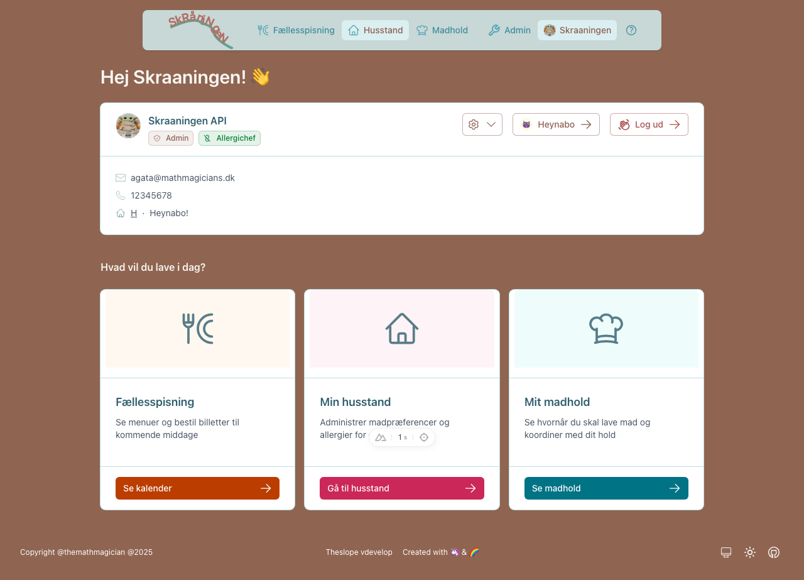
*Forsiden: dit profilkort med tandhjulet til Mine indstillinger, og genveje til kalender, husstand og madhold*

> **Bemærk:** Login-oplysninger synkroniseres fra Heynabo. Hvis du har glemt dit password, nulstil det på Heynabo.

### Sådan får du appen på din telefon

Åbn [skraaningen.dk](https://www.skraaningen.dk) i telefonens browser og log ind. Forsiden tilbyder at lægge appen på din hjemmeskærm, så den åbner som alle andre apps:

- Viser forsiden knappen **Installér app**, så klik på den
- På iPhone og iPad: åbn **Del-menuen** i Safari og vælg **Føj til hjemmeskærm**
- I andre browsere: åbn browserens menu og vælg **Føj til startskærm**

Klik **Ikke nu**, hvis du hellere vil blive i browseren.

### Mine indstillinger

På forsiden sidder dit profilkort. Klik på **tandhjulet** i kortets hjørne, så folder **Mine indstillinger** sig ud nedenunder. Klik på **blyanten** for at ændre, og **Gem**:

| Indstilling | Valg |
|-------------|------|
| **Notifikationer** | Slå **E-mail** og **SMS** til eller fra. SMS kræver et telefonnummer i Heynabo |
| **Farvevalg** | **Glade farver**, **Høj kontrast** eller **Til farveblinde** |
| **Tekst** | **Normal**, **Stor** eller **Større** |

> **Tip:** Klik **Send testbesked** for at tjekke, at beskederne når frem til dig.

### Sådan finder du rundt

Efter login har du adgang til:

| Sektion | Hvad du kan gøre |
|---------|------------------|
| **Tilmeldinger** | Se og book middage for din husstand |
| **Husstanden** | Se medlemmer og sæt ugentlige præferencer |
| **Allergier** | Tilføj allergier for husstandens medlemmer |
| **Økonomi** | Se fakturaer og udgifter til fællesspisning |
| **Indstillinger** | Opdater husstandsoplysninger |

---

## Beboer-opgaver

### Sådan sætter du ugentlige præferencer

Ugentlige præferencer bestemmer, hvornår du automatisk bliver tilmeldt fællesspisning.

> **Automatisk opdatering:** Når du ændrer præferencer, opdateres dine fremtidige bookinger automatisk. Ændrer du f.eks. mandag fra "Ingen" til "Spisesal" eller "Takeaway", bliver du automatisk tilmeldt alle kommende mandagsmiddage. Ligeså kan du være fast frameldt på bestemte ugedage, takeaway alle tirsdage, og sen spisning onsdag efter den lange dag på arbejde.

> **Afmeldinger respekteres:** Har du afmeldt en specifik middag (f.eks. mandag den 15.), vil den IKKE blive genskabt når du ændrer præferencer. Dine manuelle afmeldinger bevares altid.

> **Ingen:** Ændrer du en dag til "Ingen", bliver du frameldt de kommende middage på den dag. Er frameldingsfristen passeret, frigives billetten i stedet og sættes til salg.

1. Gå til **Husstanden** (fanen med hus-ikon)
2. Find den person du vil redigere
3. Klik på **blyant-ikonet** ud for personen
4. Vælg spisningsform for hver dag (se [Symboler i appen](#symboler-i-appen) ovenfor)
5. Klik **Gem** - dine bookinger opdateres automatisk

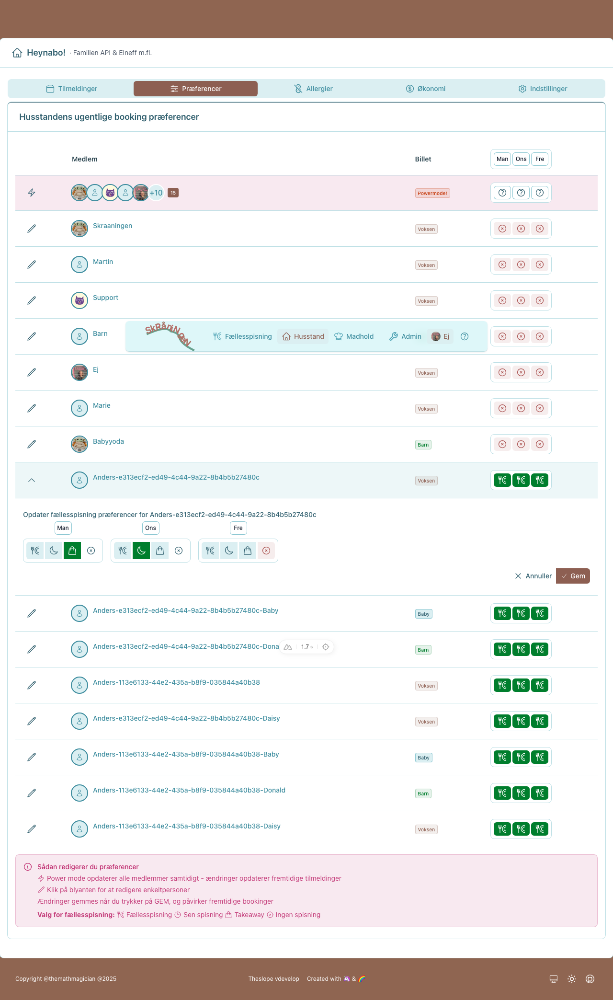
*Redigér præferencer for et enkelt medlem*

#### Power mode - opdatér alle på én gang

Vil du sætte samme præferencer for hele familien?

1. Klik på **lynikonet** (Power mode) på rækken "Alle medlemmer"
2. Vælg præferencer for hver dag
3. Klik **Gem** - alle medlemmer opdateres

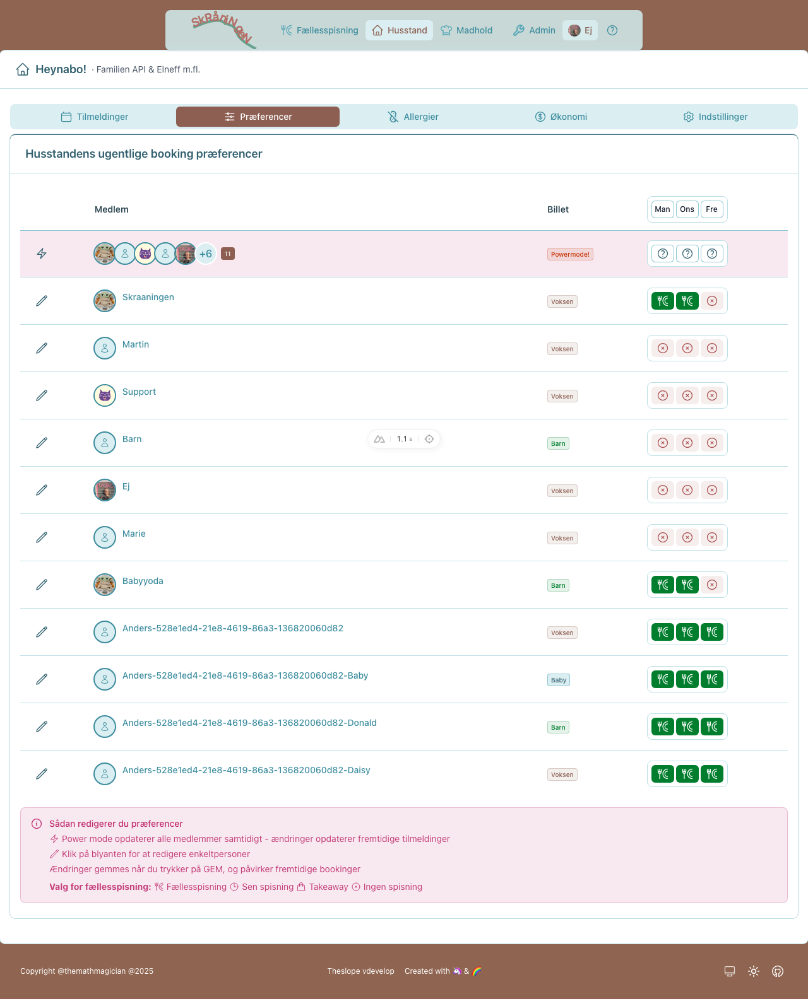
*Oversigt med alle medlemmer og deres billettype - klik på lynikonet for power mode*

### Sådan tilmelder du dig fællesspisning

Tilmelding sker automatisk baseret på dine ugentlige præferencer. Men du kan altid ændre enkeltdage:

1. Gå til **Tilmeldinger** (kalenderikonet)
2. Vælg visning: **Dag**, **Uge** eller **Måned**
3. Klik på en dag for at se/ændre tilmeldinger
4. Klik på **blyanten** for at ændre tilmeldinger

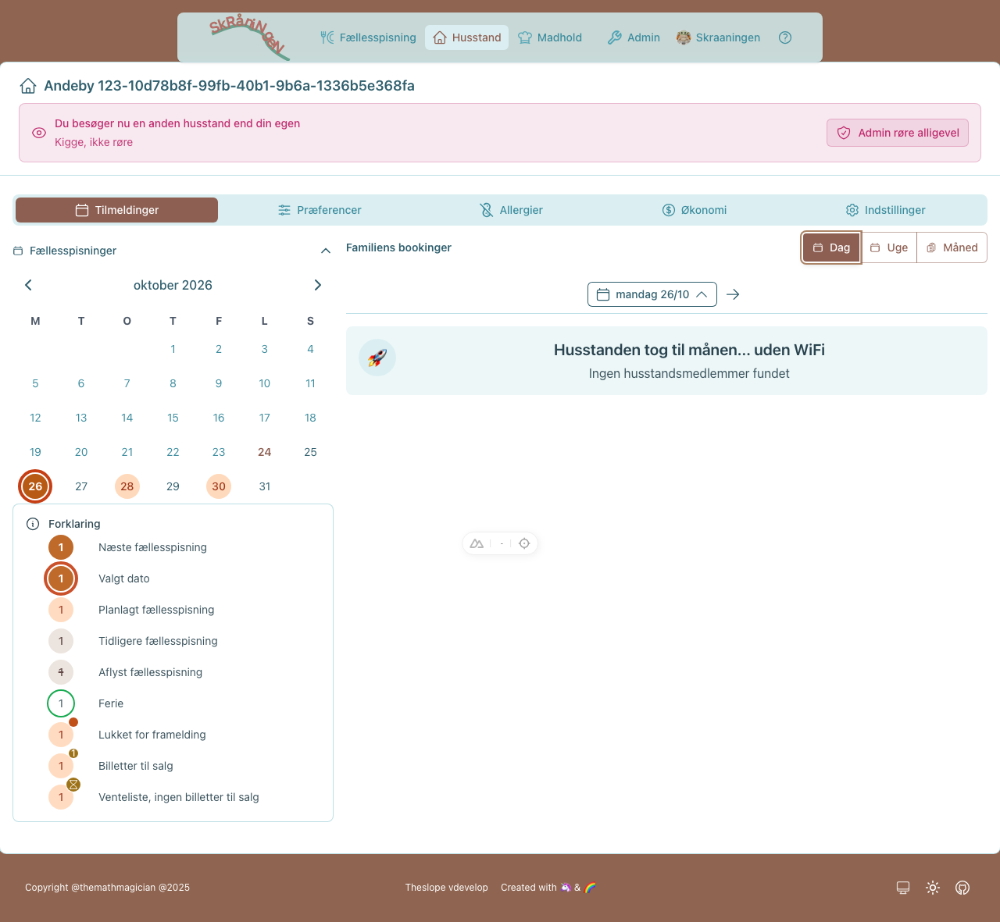
*Kalenderen viser dine tilmeldinger - vælg dag/uge/måned visning*

### Sådan ser du hvem der kommer til fællesspisning

På [Middagskalenderen](https://www.skraaningen.dk/dinner) kan du se hvem der er tilmeldt:

1. Gå til [skraaningen.dk/dinner](https://www.skraaningen.dk/dinner)
2. Klik på en middag for at se detaljer
3. Se **tilmeldingspanelet** med opdeling på spisningsform:

| Kategori | Hvad du kan se |
|----------|----------------|
| **Total kuverter** | Samlet antal tilmeldte (voksen, barn, baby) |
| **Takeaway** | Hvem der henter mad |
| **Spisesal** | Hvem der spiser i salen |
| **Sen spisning** | Hvem der kommer sent |
| **Til salg** | Billetter til salg, du kan købe - og ventelisten, når nogen venter |
| **Allergier** | Hvor mange kuverter i hver kategori der har en af menuens allergener |

**Klik på en kategori** for at se hvilke husstande der er tilmeldt, og hvem der har hvilke af menuens allergener.

Har et medlem af din husstand allergier, bærer billetten et **allergi-ikon**. Klik på **blyanten** ud for personen, så står allergierne øverst i billetten.

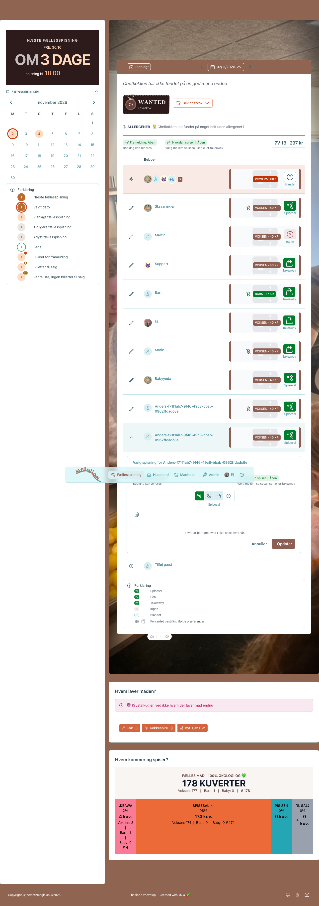
*Middagskalenderen: billetten viser medlemmets allergier*

> **Tip:** Brug oversigten til at koordinere med naboer om at hente hinandens takeaway, eller se om der er billetter til salg.

#### Uge- og månedsvisning (Grid booking)

I uge- eller månedsvisning kan du hurtigt ændre tilmeldinger for flere dage:

1. Klik på **blyanten** for at aktivere redigeringstilstand
2. Klik på en celle for at skifte, hvordan du spiser: Spisesal → Sen → Takeaway → Ingen - det, der ikke kan vælges lige nu, springes over
3. Brug **Power-rækken** øverst til at ændre alle medlemmer på én gang - dine gæster følger med
4. Se **forhåndsvisning** af ændringer før du gemmer
5. Klik **Opdater** når du er færdig - eller **Annuller** for at fortryde

Gæster har deres egen række i gitteret, så du kan ændre deres spisningsform på samme måde som familiens.

> **Forventet bestilling:** Har du ingen billet til en middag endnu, antyder kalenderen, hvad dine præferencer vil booke (**Forventet bestilling ifølge præferencer** i Forklaring). I redigeringstilstand tager første klik den til dig, og vælger du **Ingen**, er du frameldt - så booker præferencerne ikke den dag igen.

> **Aflyst middag:** En aflyst middag står streget over i kalenderen (**Aflyst fællesspisning** i Forklaring), med et **AFLYST**-bånd på dagen og **Aflyst** over kolonnen. Den kan ikke bookes, og du betaler ikke for den.

> **Tip:** Ændringer gemmes først når du klikker Opdater. Du kan frit eksperimentere og annullere.

#### Forhåndsvisning af ændringer

Før du gemmer dine bookingændringer, viser systemet en oversigt over hvad der vil ske - én linje per person og ændring, med datoerne på de middage det gælder:

| Symbol | Tekst | Beskrivelse |
|:------:|-------|-------------|
|  | **Anna tilmeldes: 20/10/2026** | Personen bliver tilmeldt fællesspisning |
|  | **Peter frameldes: 20/10/2026** | Personen bliver frameldt (før deadline) |
|  | **Peter frigiver sin billet: 20/10/2026** | Billetten sættes til salg (efter deadline) |
|  | **Anna tilmeldes igen: 20/10/2026** | Frigivet billet tages tilbage |
|  | **Anna ændrer spisemåde til Takeaway: 20/10/2026** | Samme billet, ny spisemåde |
|  | **Emil køber en billet til salg: 20/10/2026** | Køber en billet, som en anden har frigivet |
|  | **Emil skrives på ventelisten: 20/10/2026** | Ingen billet af den type til salg - Emil stiller sig i kø |
|  | **Emil ændrer spisemåde til Sen (venteliste): 20/10/2026** | Emil beholder sin plads i køen og ønsker nu at spise sent |
|  | **Emil forlader ventelisten: 20/10/2026** | Pladsen i køen opgives |
|  | **Gæst af Anna (Barn ×2) tilmeldes: 20/10/2026** | Annas to børnegæster bliver tilmeldt - gæster med samme billettype står samlet |

Gælder en ændring mere end tre middage, står antallet og den første og sidste dato, fx **Knud frameldes: 7 middage, 02/11/2026 – 14/12/2026**. Når du har gemt, får du en kvittering med én linje per person, fx *Anna: 1 købt, 2 på ventelisten (Voksen #3, Voksen #5)* - og gik noget galt, står det der også, fx *1 opdatering fejlede*.

Forhåndsvisningen hjælper dig med at:
- Se præcis hvilke ændringer du er ved at lave
- Bekræfte at de rigtige personer bliver til- eller frameldt
- Forstå forskellen på afmelding og frigivelse (afhængigt af deadline)

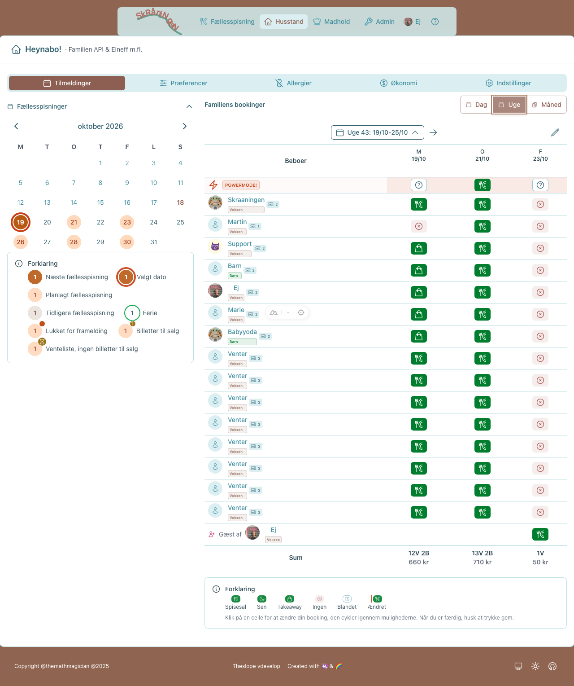
*Ugevisning: Overblik over hele ugens tilmeldinger*

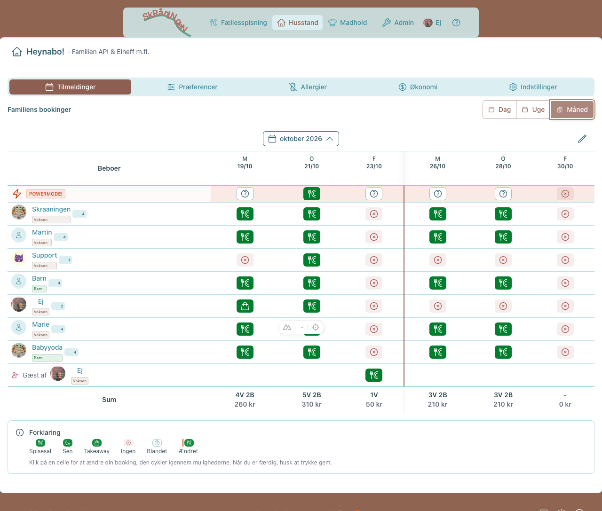
*Månedsvisning: Se og redigér hele månedens tilmeldinger*

### Deadlines

Hver middag har tre frister. Du ser dem som badges på middagen, når du åbner den:

- **Menu:** 10 dage før middagen publicerer chefkokken sin menu
- **Framelding:** sæsonens frist for at tilmelde og afmelde sig - som regel 8 dage før middagen
  - Før fristen: Du kan frit tilmelde og afmelde dig
  - Efter fristen: Du kan *frigive* din billet (se nedenfor)
- **Spisningsform:** 90 minutter før middagen
  - Du kan skifte mellem Spisesal, Sen og Takeaway indtil 90 min før
  - Madholdet skal vide, hvor mange der spiser i salen vs. henter takeaway

### Efter deadline - frigiv, køb eller skriv dig på ventelisten

Kan du ikke komme alligevel? **Frigiv** din billet, så sættes den til salg. Vil du med alligevel, **køber** du en billet til salg - og er der ingen af din billettype, skriver du dig på **ventelisten**.

| Symbol | Valg | Betydning |
|:------:|------|-----------|
|  | **Ingen** | Din billet frigives og sættes til salg |
|  | **Køb billet** | Du køber en billet af din billettype, som en anden har frigivet |
|  | **Skriv på venteliste** | Ingen billet til salg - du står i kø, fx **Barn #1** |

Ventelisten er én kø per billettype (voksen, barn og baby): først til mølle. Frigiver en anden en billet af din type, eller laver køkkenholdet ekstra portioner, går billetten til den første i køen - og du får en mail. Vælg **Ingen** på din plads i køen og klik **Forlad ventelisten**, hvis du alligevel ikke skal med.

> **Bemærk:** Når du frigiver en billet, betaler du kun hvis ingen køber den. Bliver billetten solgt, slipper du for at betale - og du får en mail om det.

### Sådan bestiller du takeaway

1. Gå til [Tilmeldinger](https://www.skraaningen.dk/household)
2. Find datoen og klik på den
3. Skift til **Takeaway** i stedet for Spisesal/Sen
4. Hent maden ved takeaway-bordet 20 minutter før fællesspisning

> **Tip:** Du kan også sætte takeaway som standard under [Præferencer](https://www.skraaningen.dk/household).

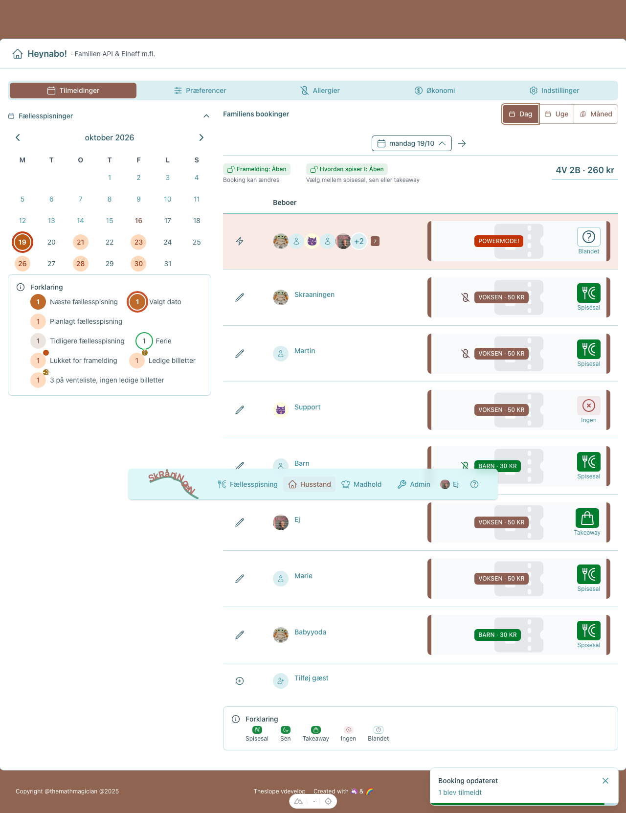
*Dagsvisning: én billet skiftet til Takeaway*

### Sådan inviterer du en gæst

Du kan tilmelde gæster til fællesspisning - de tilknyttes dig som vært.

1. Gå til [Tilmeldinger](https://www.skraaningen.dk/household)
2. Find datoen i kalenderen og klik på den
3. Klik på **+** ud for **Tilføj gæst**
4. Vælg billettype (Voksen, Barn eller Baby)
5. Tilføj evt. gæstens allergier
6. Vælg antal gæster (hvis flere af samme type)
7. Vælg spisningsform (Spisesal, Sen eller Takeaway)
8. Klik **Tilmeld gæst** (eller **Tilmeld gæster**) - efter fristen hedder knappen **Køb billet til gæst** eller **Skriv gæst på venteliste**

Gæsten vises i tabellen som "Gæst af [dit navn]" med den valgte billettype.

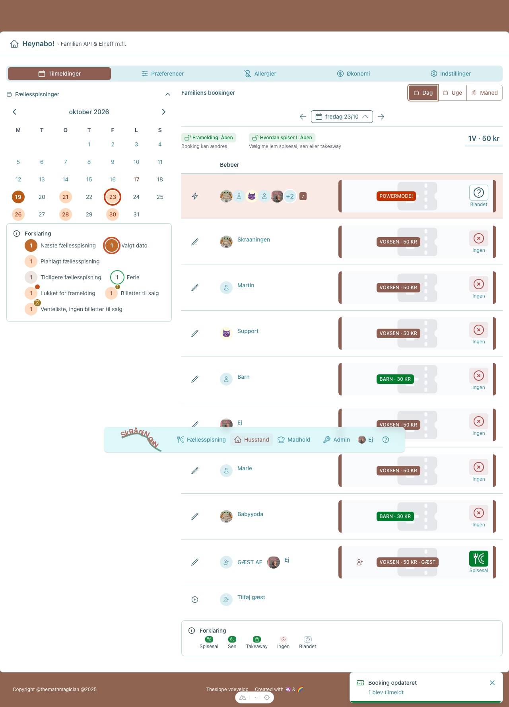
*Gæsten står nederst i tabellen med sin egen billet*

> **Bemærk:** Gæstebilletter faktureres til din husstand via PBS.

### Sådan ser du din PBS-faktura

1. Gå til **Økonomi** (pengeikonet)
2. Se oversigt over udgifter for denne og forrige periode
3. Fakturaen trækkes automatisk via PBS omkring den 1. i måneden

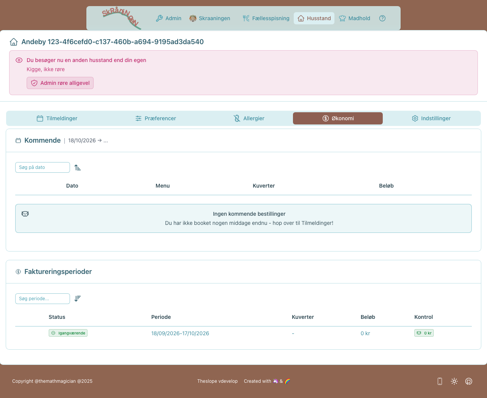

### Sådan sætter du fraflytningsdato

Skal familien flytte? Angiv en fraflytningsdato så alle jeres bookinger efter den dato slettes automatisk.

1. Gå til **Indstillinger** på jeres husstand
2. Klik på **blyanten** i Fraflytning-sektionen
3. Vælg dato i kalenderen
4. Klik **Gem** — systemet framelder bookingerne efter datoen og viser en kvittering med hvor mange der er frameldt, og hvor mange der er uændret

Har I skiftet mening? Åbn samme sektion og klik **Fortryd flytning** (to-klik bekræftelse) — bookinger genoprettes efter jeres ugentlige præferencer.

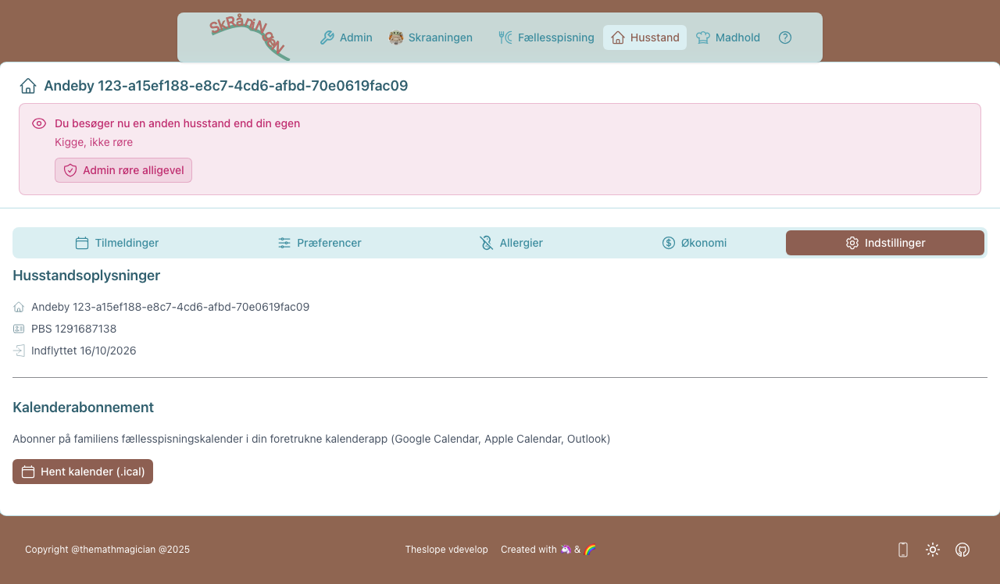

> **Bemærk:** To familier kan bo på samme adresse i en overgangsperiode. Admin opretter den nye husstand, og flytter gradvist beboere over via [Husstande-administrationen](admin-guide.md#sådan-flytter-du-en-beboer).

### Sådan tilføjer du allergier

1. Gå til **Allergier** (advarsels-ikonet)
2. Vælg det husstandsmedlem der har allergien
3. Klik **Tilføj allergi**
4. Vælg allergitype fra listen
5. Tilføj evt. en kommentar (f.eks. "mild" eller "alvorlig")
6. Gem

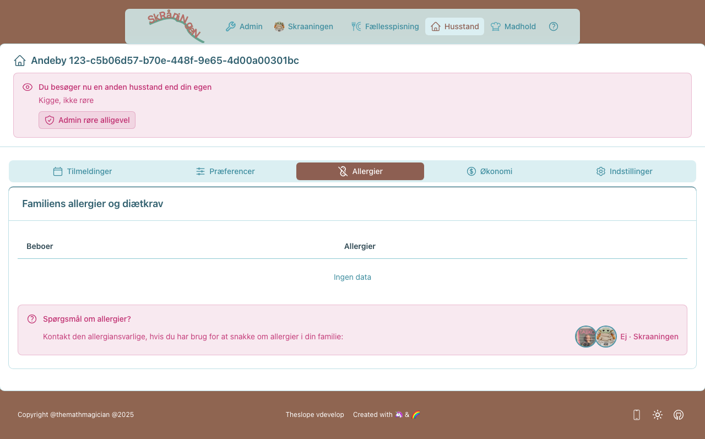

> **Vigtigt:** Kokkene ser allergierne når de planlægger menuen, og på billetterne når de tæller kuverter. Sørg for at holde dem opdateret!

---

## Chefkok-opgaver

Mangler en middag sin chefkok, lyser portrættet med et stort **WANTED** på [middagskalenderen](https://www.skraaningen.dk/dinner) — som en eftersøgt fra det vilde vesten. Når du har aftalt med dit madhold eller de andre chefkokke at du tager dagen, klikker du **Bliv chefkok**, og tjansen er din. Fortrød du? **Ændre tjans → Meld afbud** gør pladsen ledig igen. Har I aftalt at bytte? Klik **Ændre tjans → Overtag Chefkok-tjansen** på portrættet, så er dagen din, og ingen står alene tilbage med gryderne. **Læs mere om chefkokkens opgaver i [Chefkokguiden](chef-guide.md).**

Er du chefkok for et madhold? Se [Chefkokguiden](chef-guide.md) for vejledning til:

- Sådan planlægger og annoncerer du en menu
- Sådan ser du tilmeldinger og allergier
- Sådan holder du styr på indkøb og budget
- Sådan koordinerer du med dit hold

---

## Administrator-opgaver

Er du administrator? Se [Administratorguiden](admin-guide.md) for vejledning til:

- Sæsonplanlægning og oprettelse af middage
- Madhold og teamfordeling
- Import fra Heynabo og CSV

---

## FAQ

*Spørgsmål tilføjes løbende baseret på brugerhenvendelser.*

---

## Har du brug for hjælp?

### Hurtig hjælp
Klik på **?-ikonet** i øverste højre hjørne for kontekstafhængig hjælp.

### Rapportér fejl eller kom med forslag
Klik på **?-ikonet** og vælg **Rapporter fejl** - vælg Fejl, Forslag eller Spørgsmål, skriv din besked og klik **Send**. Vi læser alle henvendelser!

### Tekniske problemer
Kontakt en administrator eller opret et issue på [GitHub](https://github.com/Mathmagicians/theslope/issues).

---

*Sidst opdateret: Oktober 2026 (ventelisten, køb og frigiv efter fristen, appen på telefonen, Mine indstillinger, allergier på billetten, forventede bestillinger, aflyste middage)*
